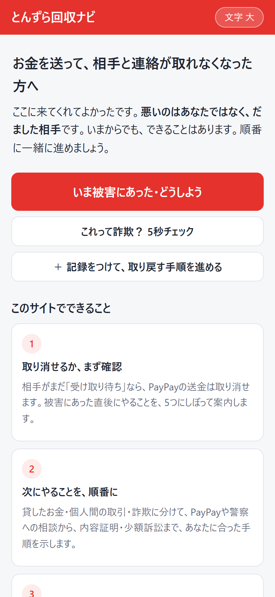
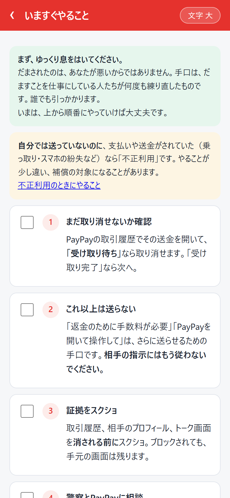
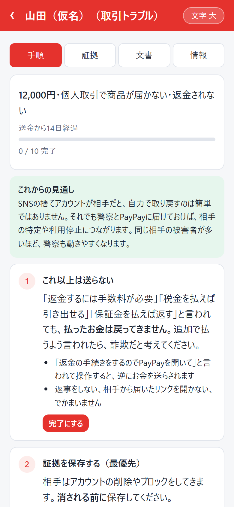
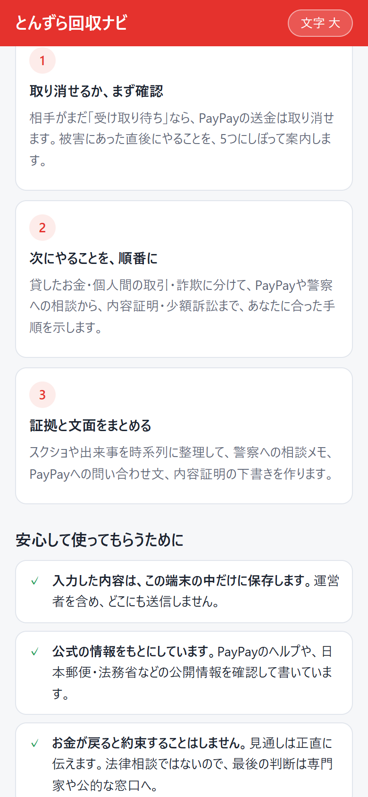
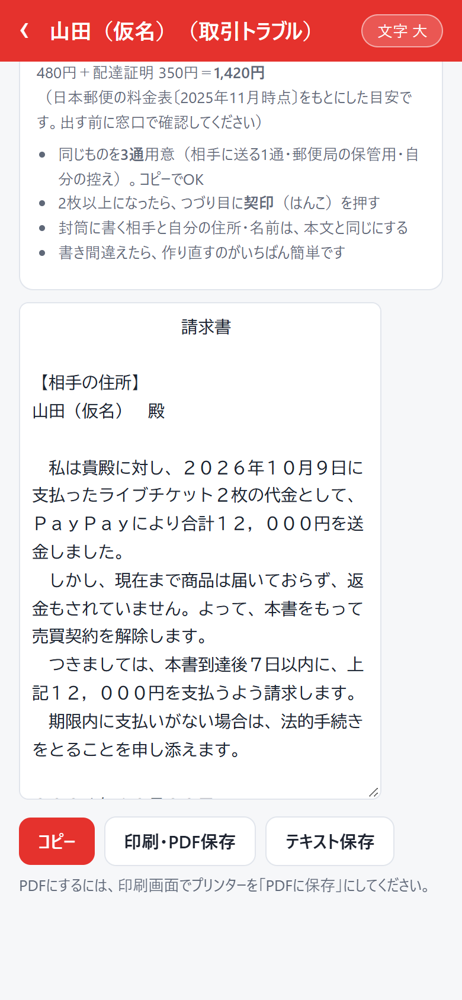

# とんずら回収ナビ

PayPayでお金を送ったあと、相手と連絡が取れなくなった人・詐欺にあったかもしれない人が、**次に何をすればいいかを順番に確認できる**無料のWebツールです。

**https://toybox-anime.github.io/tonzura-navi/**

<p>
  
  
  
</p>

## できること

- **取り消せるか、まず確認**：相手がまだ「受け取り待ち」なら、PayPayの送金は取り消せます。被害にあった直後にやることを、5つにしぼって案内します。
- **次にやることを、順番に**：貸したお金・個人間の取引・詐欺に分けて、PayPayや警察への相談から、内容証明・少額訴訟まで、状況に合った手順を示します。
- **証拠と文面をまとめる**：スクショや出来事を時系列に整理して、警察への相談メモ、PayPayへの問い合わせ文、相手への請求メッセージ、内容証明・訴状の下書き、証拠説明書を作ります。
- **内容証明を窓口のルールに合わせて整える**：1行20字・1枚26行に自動で整形し、枚数と料金の目安を出します。
- **これって詐欺？チェック**：まだやりとりの途中の人が、これ以上お金を失わないためのチェックです。
- **手口別の解説ページ**：返金詐欺、チケット詐欺、投資・ロマンス詐欺、貸したお金、不正利用（身に覚えのない利用）など。

<p>
  
  
</p>

## 大事にしていること

- **入力した内容は、端末の中だけ**：被害の記録や画像は、ブラウザの localStorage と IndexedDB にだけ保存します。サーバー、アクセス解析、広告、Cookieは使いません。
- **公式の情報だけを書く**：PayPayのヘルプ、日本郵便、法務省、金融庁などの公開情報で確かめたことだけを書き、解説ページには出典と最終更新日を載せます。
- **お金が戻ると約束しない**：見通しは正直に伝えます。「取り戻せます」と近づいてくる回収詐欺（二次被害）への注意も入れています。
- **法律相談はしない**：手順の案内と書類の下書きまでです。最終判断は、警察・消費生活センター・弁護士などに任せます。
- **被害にあった人を責めない**：焦っている人が読めるように、短い文と、やさしい言葉で書きます。

## 構成

ビルドはありません。素のHTML/CSS/JavaScriptを、GitHub Pagesでそのまま配信しています。

```
index.html / app.js / style.css   アプリ本体
about.html                        運営者情報・プライバシーポリシー
guide/*.html                      手口別の解説ページ（生成物）
tools/build_guides.py             解説ページと sitemap.xml を生成する（内容と出典はここに書く）
tools/make_images.py              OGP画像 og.png と共有用の注意カード card.png を作る（Pillow）
tools/check.py                    公開前のチェック（リンク切れ、消してはいけない文言、外部通信など）
ROUTINE.md                        3日に1回の改善ルーティン（クラウドのClaude）の決まり
```

## 手元で動かす

```bash
python -m http.server 8765
```

ブラウザで http://localhost:8765/ を開きます。

解説ページを直すときは、`guide/*.html` を直接編集せずに、`tools/build_guides.py` を直して実行します。

```bash
python tools/build_guides.py
python tools/check.py
```

## 改善の進め方

3日に1回、クラウドのClaudeが [ROUTINE.md](ROUTINE.md) の決まりに従って小さな改善を1つ入れ、PRを出します（ラベル `routine`）。人がPRを確認してマージすると、そのまま公開されます。情報を変えるPRには、確認した公式情報のURLと確認日を必ず書くことにしています。

## 開発記

- [PayPayで送金して逃げられた人のための無料ツールを、素のHTML/JSで作った（Zenn）](https://zenn.dev/nanotoylab/articles/ea4df4b316beae)

## 運営者

ナノトイラボ（現役のSEが休日に個人で開発・運営しています）。PayPay株式会社や警察などの公的機関とは関係ありません。

運営者情報・お問い合わせ：https://toybox-anime.github.io/tonzura-navi/about.html

個別の被害のご相談や、回収のご依頼にはお答えできません。困っているときは、警察相談専用電話（#9110）や消費者ホットライン（188）などの公的な窓口に相談してください。
